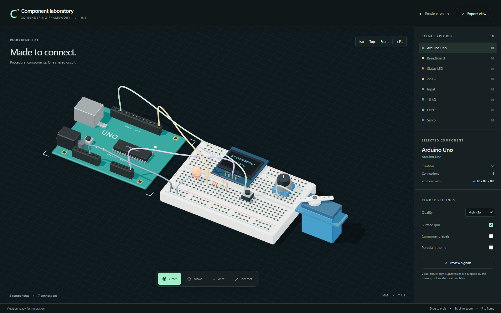

# Circuit Renderer

A standalone, controlled React 19 viewport for a desktop electronics workspace. This package supplies the 3D rendering layer. The host supplies application navigation, projects, persistence, undo, simulation and AI.

Agent A's navigation and wire-editing implementation is now available. Read the [API migration and host handoff](docs/AGENT_A_HANDOFF.md) and [verification record](docs/AGENT_A_VERIFICATION.md). Advanced edits require the host command/revision adapter; the full BreadBit acceptance task remains unqualified.



## Start the component laboratory

```sh
npm ci
npm run dev
```

Open `http://127.0.0.1:4173`. The preview is a development fixture, not the application shell. It demonstrates all eight models, signal display, wiring, placement, camera views and image export. Preview signals are fabricated display values, explicitly labelled in the UI.

```sh
npm run check
npm pack
```

The package builds to `dist/index.js` and typed declarations. Install the resulting tarball in the host, or copy this directory into a workspace package. React, React DOM, Three.js and React Three Fiber are peer dependencies, so they are not duplicated in the library bundle.

## Minimal integration

```tsx
import { useRef } from 'react';
import { CircuitViewport, workbenchFixture, fixtureSnapshot } from '@circuit-workbench/renderer';
import type { CircuitViewportHandle } from '@circuit-workbench/renderer';

export function RenderingPanel() {
  const viewport = useRef<CircuitViewportHandle>(null);
  return (
    <div style={{ height: 600 }}>
      <CircuitViewport
        ref={viewport}
        circuit={workbenchFixture}
        snapshot={fixtureSnapshot}
        quality="high"
        onSelect={selection => console.log(selection)}
      />
    </div>
  );
}
```

For editable integration, keep `selection`, circuit geometry and simulation results in the host store and implement the callbacks described in [INTEGRATION.md](./INTEGRATION.md). The renderer never writes to a Velxio store.

## Included

* Eight procedural models: Arduino Uno, 400 contact breadboard, LED, axial resistor, tactile button, potentiometer, micro servo and OLED.
* Orthographic studio viewport with local procedural environment, soft shadows, anti aliasing, calibrated colour output and three quality profiles.
* Orbit, pan, zoom, framing, top, front and isometric views.
* Component selection, grid snapped placement and rotation callbacks.
* Instanced pin targets and breadboard contacts; curved jumper cables that follow transformed pins.
* Controlled LED brightness, button press, potentiometer position, servo angle, OLED text and active wire highlighting.
* PNG export at up to 3× pixel ratio.
* A Velxio scene adapter with explicit unknown component and pin diagnostics.
* Custom component registration, themes and a fallback for failed WebGL startup.

All model geometry, labels and environment lighting are generated locally. The viewport has no asset URLs, CDN fonts, telemetry, API keys or network calls. Circuit data is not sent anywhere by this package.

## Controls

| Tool | Pointer | Keyboard while viewport is focused |
| --- | --- | --- |
| Select | Select a part or cable; choose among overlapping targets | F fits; 1/2/3 choose isometric/top/front; plus/minus zoom |
| Pan / Orbit | Explicit primary-button camera tools; wheel pans by default; Ctrl/Meta wheel zooms | Arrows pan or orbit; visible zoom/fit controls |
| Move | Drag to preview, release to commit; or click a part and click its destination | Arrows move; Shift multiplies by ten; R rotates; Enter commits placement |
| Wire | Source, optional bends, destination; selected wires expose reconnect/route controls with host command support | Escape cancels; keyboard pin picker can call the same handle methods |
| Interact | Hold a button; click a potentiometer to advance by 0.1 | Space holds the selected button; arrows adjust a selected potentiometer |

Escape cancels previews and retains selection. Window blur, cancellation and pointer release clear held input. Shortcuts respect modifiers and text/control focus. A component with `locked: true` can still be inspected or wired but cannot be moved or rotated.

## Design

The visual direction is restrained industrial design: graphite background, mint selection, warm key light, cool fill light, legible markings and lightly rounded material edges. Porcelain is included as an alternative theme. Native system fonts keep the preview offline. Camera motion is direct; there are no decorative animations. Signal animation occurs only when requested by the host or enabled in the fixture.

The catalogue models approximate familiar form factors. They are not manufacturing CAD, mechanically exact footprints, or electrical models. Use the registry to supply exact models and pin metadata for additional parts.

## Verification

`npm run check` runs type checking, topology/geometry and adapter tests, the library build and the preview build. `node tests/browser.mjs` runs the integration browser suite against a running preview and writes screenshots and a JSON report to `verification/`. Set `CHROME_PATH` to use another Chromium executable.

The browser suite checks WebGL rendering, screen-space candidate picking, atomic wire/route callbacks, cancellation, keyboard movement, camera persistence, input release, context restoration, scene PNG capture, quality profiles and idle rendering. Set `PREVIEW_URL` for a custom preview address, `PLAYWRIGHT_MODULE` for an existing Playwright module, or `SOFTWARE_RENDERING=1` for an explicitly labelled SwiftShader run. Results cover this component preview, not physical-trackpad usability, the integrated BreadBit workflow, or firmware simulation.

## Deliberate boundaries

No simulator, SPICE solver, project format, application shell, accounts, AI provider, native installer or persistence is included. Components resting on a breadboard do not automatically create electrical connections. The host remains responsible for those connections. A renderable connection is not a declaration that a circuit is electrically valid.
