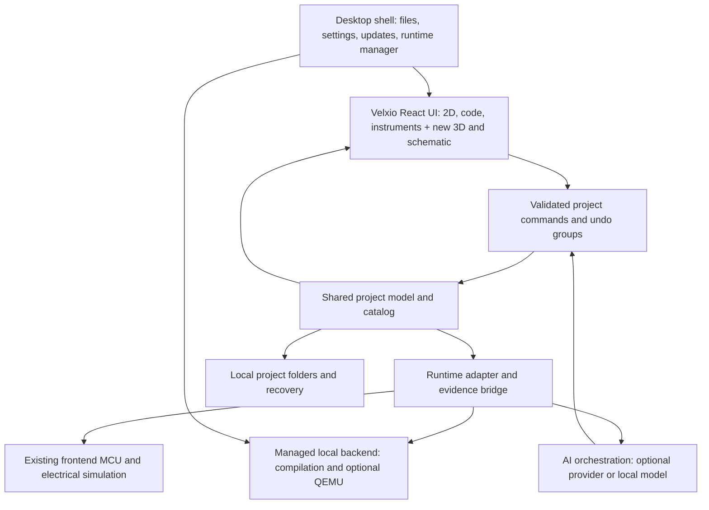

**Velxio-based desktop electronics workspace — revised product and implementation plan**

**Implementation scope amendment:** BreadBit now has a desktop development foundation in this repository. The latest user instruction resumes 3D: integrate the contributed circuit-renderer package with the existing workbench. See [3D integration](docs/3d-integration.md). See [implementation status](docs/implementation-status.md) for completed modules, validation and remaining gates. The initial 3D viewport and shared editing bridge are implemented; full physical-layout qualification remains a roadmap item.

Revision: 20 October 2026. This replaces the original greenfield browser-platform implementation plan. The original competitor research remains useful background.

**Product decision:** Adapt the public Velxio codebase into an installable desktop electronics development app. Reuse its editor, compilation integrations, supported emulators, component behavior and circuit infrastructure. Add synchronized 2D/3D construction, readable editable schematics, dependable local project storage, and an AI assistant that diagnoses problems using actual project and simulation evidence.

The intended experience is a local electronics workbench: open a project, place and wire parts, write firmware, compile locally, run the simulation, manipulate inputs, inspect the same circuit in different views, and ask AI to explain or repair a problem.

**Evidence and assumptions.** Findings below are based on current repository documentation and selected source files, not a completed clone/build or runtime audit. Documentation and source can disagree; the first milestone pins a commit and establishes what that exact revision can build and run. Recommendations and estimates are design choices. Windows-first is a planning assumption for the initial prototype, followed by macOS/Linux; mobile is outside this plan. The user's open-source versus proprietary distribution preference remains undecided and does not prevent preparing the technical plan.

**1. What changes from the original plan**

| Previous direction | Revised direction |
|---|---|
| Build a new browser platform | Adapt a pinned Velxio revision into a desktop product |
| Assemble MCU integration from individual libraries | Preserve Velxio's qualified emulator and peripheral paths, adding adapters where needed |
| Build a new 2D editor immediately | Retain Velxio's 2D editor and improve it incrementally |
| Introduce a new analog/DC engine | Audit and reuse Velxio's existing electrical-analysis path before choosing any replacement |
| Cloud compilation | Local managed Arduino CLI/toolchains; optional cloud services later |
| PostgreSQL and hosted project storage | User-owned project folders, native save/open, local recovery and versioned files |
| Browser deployment as primary release | Signed installers, native service lifecycle, optional engine packs and update management |
| Generic new AI tool surface | Adapt existing MCP/domain operations and add genuine simulation/evidence tools |
| New application architecture replacing everything | Introduce a command/model boundary around existing code without a broad rewrite |

The differentiator remains synchronized understanding: a selected pin, fault or signal should have the same identity in the physical workspace, schematic, firmware context and test evidence. Desktop delivery adds reliable local ownership and offline workflows, but does not itself improve electrical accuracy.

**2. What we can establish about Velxio**

| Finding | Evidence and planning consequence |
|---|---|
| Reusable frontend stack | The package manifest includes React, TypeScript/Vite, Monaco, Zustand, AVR8js and RP2040js. Retain these initially. [Manifest](https://github.com/davidmonterocrespo24/velxio/blob/master/frontend/package.json) |
| Different runtime paths | Public documentation distinguishes frontend AVR/Pico execution from backend QEMU execution for relevant ESP32 variants. Build a runtime availability matrix per OS rather than assuming all boards work identically. [README](https://github.com/davidmonterocrespo24/velxio) |
| Hosted/self-hosted differences | The current README excludes several hosted board families from the self-hosted image. Published board totals are not our supported desktop catalog. Confirm source, binaries, models and redistribution rights separately. [Board availability](https://github.com/davidmonterocrespo24/velxio#supported-boards) |
| Complete desktop shell is not public here | Desktop documentation explicitly places the Tauri shell in a closed build and identifies public renderer integration. Budget our own shell unless separately licensed. Buying a hosted/desktop subscription is not assumed to grant redistribution rights. [Desktop build documentation](https://github.com/davidmonterocrespo24/velxio/blob/master/docs/desktop-app.md) |
| Existing electrical infrastructure | Architecture documentation describes an ngspice-WASM electrical layer. Public source includes electrical stores/hooks, pin management, signal routing and bus integration. Audit shipped assets, coupling and fidelity before making accuracy claims or adding another solver. [Architecture](https://github.com/davidmonterocrespo24/velxio/blob/master/docs/ARCHITECTURE.md), [simulator store](https://github.com/davidmonterocrespo24/velxio/blob/master/frontend/src/store/useSimulatorStore.ts) |
| Existing portable projects | `vlxFile.ts` defines a versioned JSON project snapshot containing boards, files, components and wires. Preserve import/export compatibility and extend our native format carefully. [Project serialization](https://github.com/davidmonterocrespo24/velxio/blob/master/frontend/src/utils/vlxFile.ts) |
| Useful MCP starting point | Public docs expose circuit operations, import/export, code generation and compilation. `run_project` is described as compilation plus marking an artifact ready; it is not evidence that an assertion-based simulation was executed. [MCP documentation](https://github.com/davidmonterocrespo24/velxio/blob/master/docs/MCP.md) |
| Hosted AI is not the public integration contract | Basic, Agent and Tutor modes are documented for the product. Their full implementation and entitlements must not be assumed available from the public repository. [AI documentation](https://velxio.dev/docs/ai/overview/) |

Some documentation still describes a broader self-hosted board set than the current README. Treat this as an audit task, not a reason to silently select the most generous claim. The new product supports only paths reproduced on a clean machine from the pinned revision and permitted dependencies.

**3. Desktop architecture**

**Recommendation: Tauri 2 with Velxio's React frontend and a managed local Python/FastAPI backend.** Add Three.js to the frontend for 3D. Keep the existing backend implementation first; rewriting it in Rust would add unrelated work. Tauri supports bundled sidecar executables, including packaged Python services, with platform-specific binaries. [Tauri sidecars](https://v2.tauri.app/develop/sidecar/).

The native shell owns process startup, health checks, configuration paths, graceful shutdown and crash recovery. It loads packaged application assets, not the hosted Velxio editor. A UI window closing must not leave compiler or QEMU children running.

Initially preserve backend HTTP/WebSocket interfaces behind a transport adapter. Bind only to loopback, use an ephemeral port and per-launch secret, validate Origin/Host and authenticate WebSocket handshakes. Prefer native IPC for filesystem access and narrowly scoped operations. Ordinary loopback access is not authorization. Do not expose unrestricted filesystem/shell tools to the renderer or AI.

Keep simulation lifecycle independent of the selected view. Audit whether existing component behavior is coupled to mounted UI elements: hiding the 2D canvas must not unregister peripherals, detach buses, reset models or duplicate subscriptions. If coupling exists, extract model registration into a headless runtime layer before unmounting views. This is an important risk specific to adapting a working visual simulator.

**Tauri versus Electron.** Start with Tauri because it fits the documented integration direction and supports the required sidecars. Its OS webviews introduce platform variation, so test Monaco, WebGL, workers, WASM, audio and keyboard input. Electron is a fallback if repeatable compatibility failures make bundled Chromium worthwhile; do not implement two shells in parallel. [Tauri webview differences](https://v2.tauri.app/reference/webview-versions/).

**Desktop runtime packaging.** The first release should not require users to install Node, Python, Rust or Docker. Package the backend runtime and manage approved toolchains. AVR/Uno is the initial supported path. Download additional board packs with versions, hashes, licenses, sizes, progress and removal controls. A Linux QEMU shared library from a Docker image does not automatically run on Windows or macOS; native ABI/build/bridge validation is a separate milestone. Docker/WSL can help development but should not become an undeclared end-user requirement.

Cloud AI and initial downloads need connectivity. After a board pack, libraries and assets are installed, normal editing, builds and qualified simulations should work offline. External network experiments remain explicitly network-dependent. Disable unrelated hosted news/auth/analytics calls in the desktop product configuration; show a clear network activity policy.

**4. Reuse, adapt and build**

| Area | Action | Initial scope |
|---|---|---|
| Code editor and compile diagnostics | Reuse | Preserve Monaco and existing firmware workflows |
| 2D components and wiring | Reuse, regression-test | Keep the working editor while introducing common commands |
| MCU/peripheral integration | Reuse and qualify | Uno first; preserve other valid paths without advertising untested desktop support |
| Electrical simulation and instruments | Audit, then reuse | Retain verified behavior; publish model limitations and actual timing coverage |
| Desktop shell | Build or separately license | Native open/save, local service management, settings, installer and updates |
| Shared model boundary | Adapt | Stable IDs, command validation, revisions, atomic code/circuit edits |
| 3D workspace | Build | Original/licensed assets, pin anchors, placement, wiring, runtime animation |
| Schematic generation/editing | Build | ELK plus domain rules, editable geometry and equivalence checks |
| AI integration | Adapt and extend | MCP-compatible operations plus run control, trace access and bounded test execution |
| Local persistence | Adapt | Native project package, autosave, crash recovery, `.vlx` interchange |
| Catalog qualification | Build process around existing catalog | Separate visual availability, simulation support and 3D readiness |

Do not create a second simulation path just for 3D. Do not assume an existing picture or component name guarantees a working model or suitable 3D mesh.

**5. Shared model and incremental migration**

Wrap current state mutations with a domain command facade. Preserve existing component/board IDs and pin aliases. Add versioned side data for physical anchors, schematic symbols, asset references, model coverage, tests and provenance. Existing source areas to assess include `useSimulatorStore`, `useEditorStore`, `useElectricalStore`, `PinManager`, `PinResolver`, `SignalRouter`, breadboard utilities and `vlxFile.ts`; these are integration candidates, not a completed code audit.

Separate four concerns:

1. **Electrical design:** components, exact pins, contacts, wires, net membership, power domains and parameters.
2. **Representations:** shared physical placement for 2D/3D, independent schematic placement/routing, camera and selection.
3. **Firmware/build:** source files, board, libraries, compiler inputs and immutable artifacts.
4. **Runtime/evidence:** device state, virtual time, serial, signals, inputs, assertions and model limitations.

One validated transaction can update wiring and firmware together, with base revision, file-hash preconditions and an idempotency key. One undo reverses the design change. Runtime time-travel requires a checkpoint/replay facility and is not implied by undo.

The authoritative circuit must remain independent of pixel or mesh coordinates. Explicit pin/hole attachments determine conductivity; crossing lines, wire colors and overlapping meshes do not. Breadboard models define bus strips, gaps and split rails. Do not collapse a resistor or LED into a conductive wire.

**Persistence recommendation.** Use a native project folder containing a manifest, source files, layout data, catalog lockfile, scenarios and optional trace artifacts. Use temporary-file-plus-atomic-replace writes and a recovery journal. Keep caches/toolchains in app data, outside the project. Add a local recent-project index only if needed; no central database or login is required for the core workflow.

Import `.vlx` through the existing parser plus migrations; export a compatible subset with an explicit warning if 3D, schematic or test metadata will be omitted. Do not hide new required fields in a format that upstream readers might discard. Keep the original import and provide migration tests. Detect externally edited source files and resolve conflicts rather than overwriting them.

**6. 3D and schematic experience**

**3D is part of construction, not only a decorative viewer.** Begin with a tabletop plane, orbit/zoom, selectable components, named pin targets, a top-view shortcut and constrained component placement. Add pin-to-pin wire creation with snapping and a visible endpoint preview. Initial wire routes can be generated with editable bends; realistic cable physics is unnecessary.

For each supported component, define the mesh's units, orientation, origin, pin anchors, polarity, dimensions, interaction targets and runtime bindings. Clicking a 3D button sends the same input command as 2D. An LED reads existing simulated output state. Display pixels can feed a texture; a servo can show modeled/commanded angle, with mechanical omissions disclosed. Changes to placement preserve connectivity only when the attachments remain unchanged; otherwise preview the resulting net changes.

Use canonical physical units. Convert existing 2D coordinates through a documented migration/calibration; never assume every imported SVG uses identical physical scale. Wire endpoints follow pins, while presentation route points remain separate. A generic proxy mesh can represent an unmodeled visual part only if it is visibly labeled; it cannot claim accurate fit or pin placement.

**Schematic generation** starts from resolved connectivity, then applies symbol selection, functional grouping, placement constraints, orthogonal routing and label cleanup. Compare resulting pin-net membership against the input before accepting it. Preserve manual positions and locks; offer local tidy rather than rearranging a whole sheet after every edit.

**Reverse edits** remain explicit: adding a connection in the schematic may require a jumper or a moved breadboard lead. Propose the physical realization and commit it atomically. If ambiguous or impossible, keep a pending proposal. Deleting drawn ink cannot break a real breadboard bus. Never display simulation results from an intended connection as though it were already physically realized.

The desktop workspace should have Build 2D / Build 3D / Schematic tabs, dockable code and instruments, and an AI panel tied to selection. Advanced users can split views. All views share selected component/net, run state and diagnostics. Keep keyboard-accessible endpoint lists and readable labels so 3D precision is not mandatory for completion.

**7. Simulation policy**

Preserve working Velxio engines first. Establish a frozen upstream regression suite before changing timing or state routing. Do not promise deterministic replay or general mixed-signal accuracy merely because an engine is present. The clock, frontend/backend boundary and electrical solve schedule need inspection and measurement for each runtime.

| Edit | Product behavior |
|---|---|
| Change view, camera, selection or wire appearance | Continue the same run with no reset |
| Move schematic symbols or geometry while preserving contacts | Continue the same run |
| Press a button, move a supported knob, send serial input | Apply a timestamped input at a safe runtime boundary |
| Change topology, physical contacts or component type | Validate, re-elaborate and restart by default |
| Change a nominal electrical parameter | Restart unless the adapter has tested live-update semantics |
| Change firmware, libraries, board or compile-time clock | Build locally; restart with the matching artifact on success |

Associate traces with a run ID, source/binary hashes, electrical configuration, engine/model versions and input log. Never silently load an old binary after a failed build. Stop reporting a run as current when its electrical semantics have changed. A supported cosmetic edit may keep the run compatible despite a new document revision.

Existing analog behavior is a candidate for reuse. Qualify LED/resistor, divider, floating-input and contention fixtures first; then RC/PWM/ADC coupling. Show unsupported, non-convergent and indeterminate states. If the public electrical assets or coupling cannot meet the selected scope, narrow the release contract and explicitly budget a repair/alternative. Do not carry forward the old assumption that a new DC solver must be written from scratch.

**8. AI assistant**

Offer Explain, Suggest and Apply actions. An explanation request does not modify a project. Use approved component definitions, exact circuit connectivity, current firmware, compiler output, serial data and recorded traces as context.

Adapt existing MCP tools behind the same command/validation facade used by the UI. Add `inspect_project`, `trace_net`, `validate_candidate`, `start_simulation`, `inject_input`, `run_scenario`, `read_serial`, `read_trace` and `apply_candidate`. These are proposed new contracts, not claims that they already exist in public Velxio. The app-hosted runtime must actually acknowledge execution and return recorded results; an artifact marked ready is insufficient.

The repair loop is: snapshot → inspect → propose → validate → compile → execute bounded test → compare evidence → preview → apply. Stage candidates separately so testing does not silently alter the user's current project. Commit wiring and firmware as one undo group. Keep fixed acceptance tests outside the AI's authority to weaken expected outcomes.

First scenario: the program reads D2 but the button is wired to D3. AI traces the actual net, identifies the mismatch where source analysis supports it, proposes either a wire change or a code change, and runs released/pressed/released assertions after the repair. A separate missing-resistor example verifies electrical diagnostics rather than pretending digital blinking proves hardware correctness.

Use visible evidence states: checked statically; compiled; observed in simulation; behavioral assertion passed; hardware unverified. Missing coverage cannot receive a pass. Set limits on tool calls, token use, compilation time, trace volume and simulation duration. Untrusted imports/comments/datasheets cannot expand tool permissions.

For the prototype, support optional bring-your-own API credentials through the OS credential store, never in project files or renderer storage. A managed AI subscription can follow. Local models are optional and separately evaluated; installing a desktop app does not make a hosted model offline. No provider secret should be embedded in a distributed executable. Core editing and simulation remain usable with AI disabled.

**9. First proof of concept and MVP**

**POC:** one installable Windows app, one Uno R3, one breadboard, resistor, LED and button, a real locally compiled sketch, shared 2D/3D editing, a simple equivalent schematic, and one AI-assisted wiring repair.

Acceptance conditions:

- A clean machine installs and launches without a development environment or Docker.
- The setup flow installs/verifies the AVR pack; subsequent offline editing, builds and simulation work.
- Changing views keeps the same running instance, input state, component IDs and connectivity.
- A wire can be created in 3D and inspected/edited in 2D; snap targets map to the intended pins.
- The schematic preserves connectivity, and a simple schematic edit produces an explicit physical wiring plan.
- Button input produces an observable firmware/LED response; the fault test fails before repair and passes afterward.
- AI cites the actual run evidence; unsupported electrical claims remain unresolved.
- Save/reopen, undo and crash recovery preserve the design. No child process remains after exit.

**Private MVP:** expand to 15–20 fully qualified component types, five polished example projects, robust native persistence, digital probes/serial traces, useful electrical diagnostics, constrained 3D construction, editable schematics, and bounded AI construction/repair. Preserve reusable upstream features where they work, but distinguish experimental imported capabilities from our supported catalog.

**Deferred:** native ESP32/QEMU distribution until independently validated; full Pico qualification as the next likely family; hosted-only boards absent a suitable agreement; broad mixed-signal guarantees; arbitrary community models; cable physics; full PCB design; multiplayer; and app-store expansion. Native hardware upload can follow explicit device-selection and permission work.

**10. Revised roadmap and prioritized experiments**

Estimates assume approximately four experienced engineers covering frontend/3D, runtime/backend, desktop packaging and AI/model integration, with design and electronics QA support. They are planning ranges, not commitments or measured development effort.

| Stage | Estimate | Deliverable / gate |
|---|---|---|
| A: Reuse and distribution audit | 1–2 weeks | Pin upstream commit; reproduce Uno build/run; map OSS/pro boundaries; identify assets/binary rights; inventory runtime/UI coupling and tests |
| B: Local desktop baseline | 2–3 weeks | Own Tauri shell, packaged backend, managed AVR pack, local open/save, clean-machine install and offline repeat build |
| C: Defining POC | 4–6 weeks | Shared command boundary; five-part 2D/3D scene; simple schematic; actual AI run-and-repair loop |
| D: Private MVP | 6–10 weeks | Qualified catalog, resilient persistence, schematic editing, instruments, usable AI previews and signed release pipeline |
| E: Broader desktop support | After gates | macOS/Linux packages, Pico/ESP32 qualification, improved 3D editing and more electrical coverage |

Allow roughly 7–11 weeks through the POC and 13–21 weeks through a private MVP under these assumptions. Upstream packaging gaps, unavailable binaries, license negotiations or tightly coupled runtime code can extend this. Reuse reduces new emulator work; it does not eliminate integration, testing or catalog work.

| Priority | Experiment | Decision gate |
|---|---|---|
| P0 | Clean-machine local app | No dev tools required; offline repeat build succeeds; startup/exit and process cleanup work |
| P0 | Public availability matrix | Every advertised MVP feature is reproducible from the pinned revision and permitted artifacts |
| P0 | Runtime independence from views | Repeated view changes do not reset, duplicate or detach device models; no trace discontinuity caused by view toggles |
| P0 | 2D/3D/schematic round trip | Zero pin-net mismatches in fixtures, including rotations, split rails, save/load and undo |
| P0 | Genuine AI execution | Test demonstrably fails before repair and passes after; stale or merely compiled artifacts cannot earn a pass |
| P1 | Electrical qualification | Selected circuits agree with declared reference tolerances; unsupported/floating/contention behavior is disclosed |
| P1 | Webview performance | Proposed target: p95 interactions under 100 ms and 3D at least 30 fps for 50 components on a named baseline laptop; measure memory and battery impact |
| P1 | Native QEMU pack | Correct OS/architecture binary, bridge compatibility, shutdown and offline startup; no borrowed assumption from Linux Docker |
| P1 | Persistence/update recovery | Power-loss simulation, interrupted pack download and schema upgrade preserve recoverable projects; rollback is tested |

**11. Licensing and distribution**

Velxio documents AGPLv3 and a separately negotiated commercial license for proprietary integration. Commercial activity can use the AGPL route when its obligations are met; charging money is not by itself the trigger for needing a proprietary license. A closed-source distributed derivative should proceed only with an appropriate commercial agreement. Review source/notice obligations for the actual combined distribution. [Velxio licensing terms](https://github.com/davidmonterocrespo24/velxio/blob/master/COMMERCIAL_LICENSE.md).

The agreement, if chosen, needs to specify desktop redistribution, modified frontend/backend, target OSes, updates, branding, developer scope and any desired private shell/models/binaries. Do not assume it grants all third-party rights or hosted Pro capabilities. Audit QEMU/toolchains, firmware images, ngspice build, Wokwi assets and new 3D meshes independently. Preserve required notices and produce an SBOM for each release.

Build our own application identity, startup flow and service endpoints. Do not depend on Velxio's Pro license server or treat a subscription as a development SDK. No contact, purchase or license acceptance is part of this planning update.

**12. Revised costs and maintenance model**

The original cloud compilation/database budget no longer applies. Compilation and ordinary simulation consume the user's CPU, memory and disk. Product-side costs move toward installers and optional board-pack delivery, CI on each target OS, signing/notarization, update hosting, support, and optional AI. Avoid mandatory accounts or cloud synchronization in the first release.

Illustrative workload assumptions, USD: 10,000 users × five AI tasks/month × 12k input and 3k output tokens across all calls per task gives 600M input and 150M output tokens. At hypothetical blended rates of $1/M and $5/M, model cost is $1,350/month; five times the usage/rate yields $6,750. These are planning inputs, not quoted provider prices. With bring-your-own credentials that usage is billed to the user; with managed AI it is a product operating cost.

Budget installer delivery separately: 10,000 downloads of a hypothetical 250 MB installer transfer about 2.5 TB before board packs and updates. Actual package size and bandwidth charges must be measured/quoted. Toolchain and QEMU packs can outweigh shell size. Use on-demand packs, persistent caches and appropriate update granularity.

Commercial Velxio licensing is unpriced until quoted. Cross-platform binary maintenance and support may cost more engineering time than hosting. Pin releases, retain an upstream remote, record local patches, and run import/runtime regressions before each upstream merge. Keep new 3D, schematic and AI orchestration modules separate enough to reduce merge conflicts without assuming they are legally independent works.

**First implementation milestone:** reproduce one public Velxio Uno project locally, package it in our own desktop shell, and make that same running circuit editable in 2D and constrained 3D. Then add schematic equivalence and evidence-based AI repair before increasing board count.
